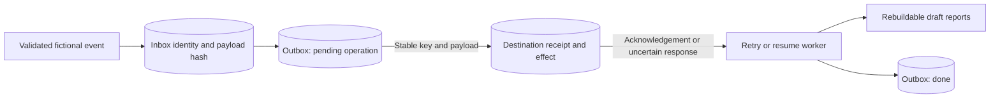

# Reliable Replay Lab

A small Python/SQLite experiment showing why retries need stable operation identities and destination receipts. It runs entirely on loopback with authored fictional inputs and Python's standard library.

## Run it

Use Python 3.10 or later. No packages, accounts or external services are required.

```sh
python demo.py
python -m unittest -v
```

Each demo creates a fresh ignored `runs/` directory containing sender and destination databases, event logs, generated draft reports and a `result.json`. To choose a location, use `python demo.py --output path/to/new-run`; that directory must not already exist.

## What it demonstrates

| Experiment | Expected result |
| --- | --- |
| Two operations replayed three times using execution-specific keys | Six destination effects |
| The same operations replayed using a durable inbox/outbox | Two destination effects |
| A transient failure, post-commit response timeout, and worker crash/restart | Three further unique effects; five total |
| Permanent destination rejection | One rejected outbox operation |
| Conflicting payload, unsafe identifier, malformed input | Three rejected inputs |
| Replay after recovery | No additional destination effect |

The crash is an actual child-process exit with code 77 after the destination acknowledges an effect but before the worker saves its local completion. The response-timeout fixture commits at the destination before delaying its response. Both cases leave an uncertain local outcome; replaying a stable key retrieves the existing destination receipt.

## Transaction boundaries



Inbox insertion and outbox creation share a local transaction. The loopback destination records the payload hash and effect under the same idempotency key in its transaction. A reused key with different content receives HTTP 409. The worker marks completion only after receipt acknowledgement and report replacement.

## Scope

This is a serial, bounded fixture experiment. It does not provide a production queue, concurrent worker leasing, remote key-retention guarantees or universal exactly-once delivery. Each worker run allows up to three delivery attempts; still-pending work can be resumed with the same database. The receiver binds only to `127.0.0.1`.

The workflow mechanism was extracted from an earlier local synthetic automation experiment. The fixture data and demonstration runner were authored for this standalone project. Tests exercise real loopback requests and process restart without access to private data.

On 12 October 2026, the standalone demo and all four integration tests passed on Windows with Python 3.13. SQLite connections close explicitly so completed experiments can release their database files. The included workflow is prepared to check Linux/Python 3.10 and 3.13 and Windows/Python 3.13 when the project is published.
